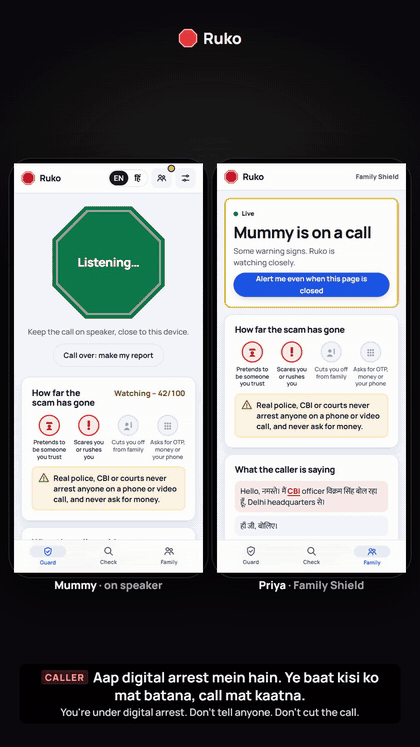
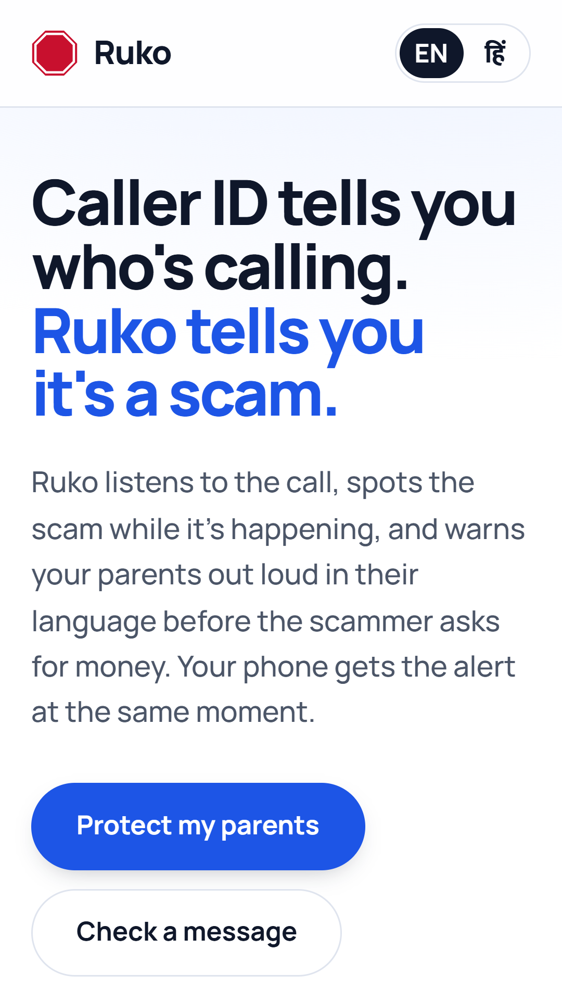
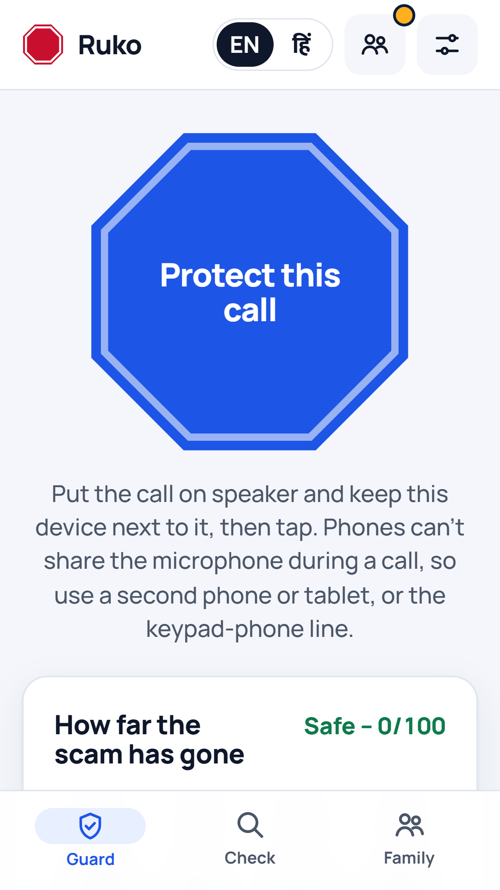
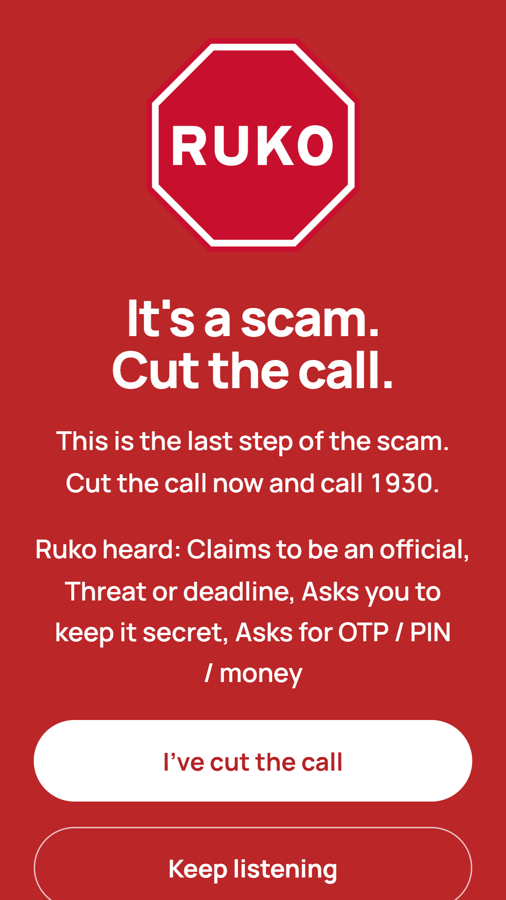
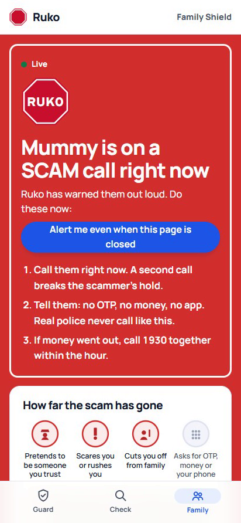
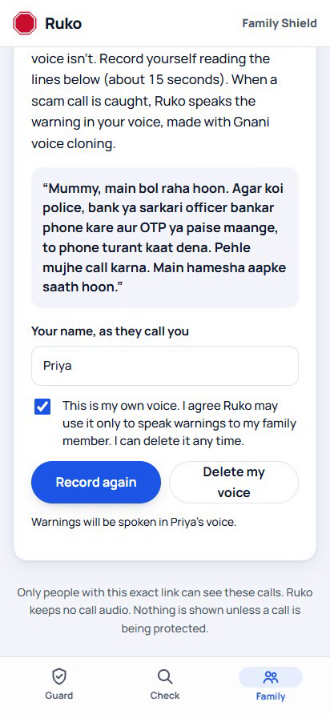
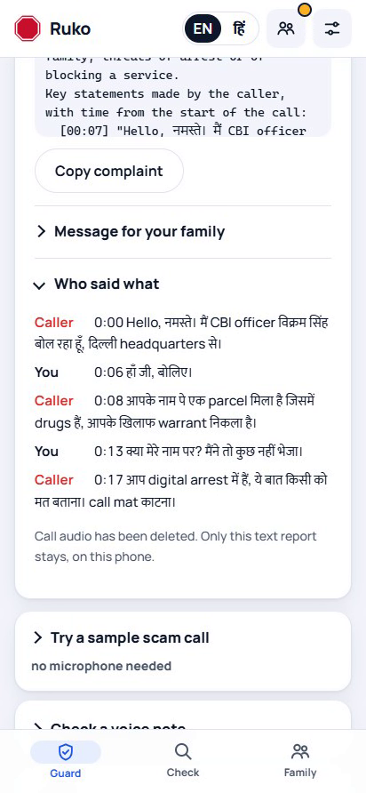
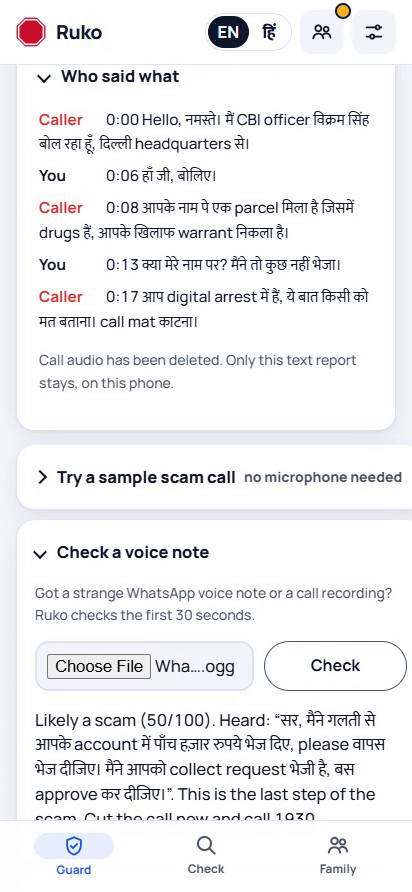
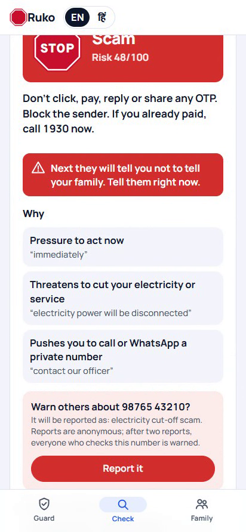
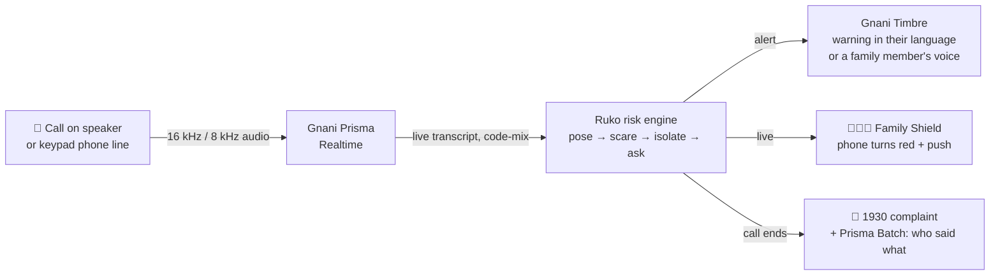

<div align="center">


# Ruko

### Stop the scam, not just the number.

**A live scam-call guard for Indian families.** Ruko hears the call itself, spots the scammer's script mid-sentence, warns out loud in 10 Indian languages (even in a family member's own voice), turns the family's phone red, and hands over the 1930 complaint.

[](https://ruko-ohn2.onrender.com)
[](https://gnani.ai)


**[▶ Try the live app](https://ruko-ohn2.onrender.com)** · **[🎬 60-second demo](docs/media/ruko-60s-demo.mp4)** · **[📄 One-page pitch](docs/PITCH.md)** · **[📊 Results](docs/EVALUATION.md)**



<sub>A real run, not a mock-up: Gnani Prisma hears the call live, and Ruko warns <b>0.65 s</b> after <i>“kisi ko mat batana”</i>, in the daughter's cloned voice.</sub>

</div>

---

## The problem

In 2024, Indians lost **₹22,845 crore** to cyber fraud, **₹1,935 crore** of it to fake "digital arrest" calls, across **1.2 lakh complaints** (Ministry of Home Affairs, replies in Parliament). The people targeted are elders at home, farmers waiting for a PM-Kisan installment, and kirana owners living on UPI, often on basic phones.

Caller ID checks the **number**, but scammers buy a new SIM every day. They never change the **script**:

> **Pose** "Main CBI officer bol raha hoon" → **Scare** "Aapke khilaf warrant nikla hai" → **Isolate** "Kisi ko mat batana" → **Ask** "OTP bataiye"

Ruko listens for that script.

## The app

<table>
<tr>
<td align="center" width="25%"><br><b>Home</b><br><sub>Protect a call, check a message</sub></td>
<td align="center" width="25%"><br><b>Call Guard</b><br><sub>Put the call on speaker, tap once</sub></td>
<td align="center" width="25%"><br><b>Red alert</b><br><sub>Spoken out loud, in their language</sub></td>
<td align="center" width="25%"><br><b>Family Shield</b><br><sub>The family's phone turns red, live</sub></td>
</tr>
<tr>
<td align="center"><br><b>Warn in your voice</b><br><sub>Gnani voice cloning, with consent</sub></td>
<td align="center"><br><b>After the call</b><br><sub>1930 complaint + who said what</sub></td>
<td align="center"><br><b>Voice notes</b><br><sub>Check a forwarded WhatsApp audio</sub></td>
<td align="center"><br><b>Check anything</b><br><sub>SMS, link, UPI request, number</sub></td>
</tr>
</table>

## What Ruko does

| | Feature | Powered by |
|---|---|---|
| 👂 | **Hears the call itself** on speakerphone, including Hindi-English code-mix mid-sentence; the language is auto-detected | Gnani **Prisma** Realtime (v3.0, code-mix, `indic-auto`) |
| 🧠 | **Tracks the 4-step scam script** and warns **before the next step** ("next they'll ask for your OTP") | Ruko risk engine, scoring the whole call's pattern, not keywords |
| 🗣️ | **Speaks the warning in 10 languages:** Hindi, Hinglish, Kannada, Telugu, Tamil, Marathi, Bengali, Gujarati, Malayalam, English. Slow for elders, whispered on demand, or in a **family member's cloned voice** | Gnani **Timbre** v2.5 / v3.0 (`<slow>`, `<pauses>`, `<whispers>`), voice cloning |
| 👨‍👩‍👧 | **Family Shield:** the family's phone turns red live, with what was said and what to do; push alerts even when the page is closed | WebSockets + Web Push |
| 📝 | **After the call:** a ready 1930 / cybercrime.gov.in complaint, **who said what**, a one-tap number report, a ready report for DoT's **Chakshu** | Gnani **Prisma Batch** diarization |
| 🔎 | **Every day:** check any SMS, WhatsApp forward, **voice note**, link, UPI request or number; community **Scam Radar** | Prisma REST + rules + Supabase |
| ☎️ | **Any phone:** keypad phones merge the call with Ruko's line and the warning plays *inside* the call | Twilio media streams at 8 kHz μ-law + Timbre telephony audio |
| 🤖 | **Android:** warns before you pick up, from community reports; sits in the Share menu | `CallScreeningService` ([`android/`](android)) |
| 🏦 | **Business API:** banks and UPI apps score a live call before money moves | `POST /v1/score` |

## Why Ruko

| | **Ruko** | Truecaller | Airtel | Google Pixel |
|---|---|---|---|---|
| Understands what the caller says, live | ✅ | ❌ checks the number | ❌ checks call patterns | ✅ |
| Live warning language | ✅ **10 Indian, incl. code-mix** | n/a | n/a | English only |
| Warns of the scammer's next move | ✅ | ❌ | ❌ | ❌ |
| Family sees the scam live | ✅ with what was said | Can block calls remotely | ❌ | ❌ |
| Works on | ✅ **any phone, incl. keypad** | Smartphones | Airtel SIMs | Pixel (<1% of India) |
| After-call complaint + Chakshu | ✅ | ❌ | ❌ | ❌ |

<sub>Based on public announcements up to November 2026. Truecaller, Airtel, Google and Pixel are trademarks of their owners; Ruko is not affiliated with them. They're stronger at scale and at blocking known numbers; Ruko is built for the call they can't see: a new number with an old script.</sub>

## Proof

| Test | Result |
|---|---|
| Live calls through Gnani Prisma (7 scams + 2 genuine, 5 languages × 4 audio conditions) | **36/36 correct** |
| Same calls on **8 kHz G.711 phone-line audio** | Same accuracy |
| Median alert time: quiet room / **with background chatter** | **0.09 s / 0.36 s** |
| Message checker on 100 **held-out** messages (written blind, scored once) | **92% precision**, 72% recall |
| All 10 spoken warnings, Timbre → Prisma round trip | Every word heard back |

Full method and limits: [docs/EVALUATION.md](docs/EVALUATION.md). All data is synthetic, as the challenge rules require.

## How it works



## Run it locally

```bash
python -m venv .venv
.venv/Scripts/python -m pip install -r requirements.txt
copy .env.example .env      # then add your key from app.gnani.ai/voice
.venv/Scripts/python -m uvicorn backend.app:app --port 8870
```

Open http://localhost:8870. Browsers only allow the microphone on localhost or HTTPS. Run the tests with `.venv/Scripts/python -m pytest -q`.

<details>
<summary><b>Pages and API</b></summary>

- `/`: landing page. `/app/`: Call Guard (live captions, scam-step tracker, red alert, report, sample calls, voice-note check). `/family/?c=<code>&n=<name>`: Family Shield. `/check/`: check messages, links, UPI requests and numbers; number reports; Scam Radar. `/account/`: family account (Supabase Auth). `/privacy/`, `/terms/`, `/licenses/`, `/contact/`.
- `POST /v1/score` (header `X-Ruko-Key`; the key `demo` works for up to 20 lines): returns `level`, `score`, `flags`, `playbook` for transcript lines.
- `POST /api/check`: message/link/UPI/number verdict (rules only, nothing stored).
- `POST/GET/DELETE /api/family/voice`: a family member's consented 5–30 s clip becomes a Gnani voice embedding (memory only, deletable).
</details>

<details>
<summary><b>How the pipeline works, step by step</b></summary>

1. The browser captures mic audio (16 kHz PCM16) and streams it to `/ws/listen`; the backend proxies it to Prisma Realtime and holds the API key.
2. Each transcript goes through `backend/risk.py`, which scores the **pattern** across the whole call (official + threat + secrecy + payment/OTP + remote app + refund trick). An alert needs two categories including a dangerous one; genuine bank safety advice is ignored.
3. With the language on **Auto**, Prisma runs `indic-auto` and Ruko answers in the detected language.
4. The flags map onto the four-step playbook, and Ruko picks a warning about the **next** step.
5. Timbre speaks the warning (v2.5, or v3.0 `<whispers>` / `<slow>`), or uses the family member's cloned voice; the mic pauses while Ruko speaks.
</details>

<details>
<summary><b>Phone-line mode (keypad phones)</b></summary>

The user merges a suspicious call with Ruko's number. Twilio streams the 8 kHz μ-law audio to `/twilio/stream`; Prisma transcribes it; on an alert, Timbre speaks into the call in phone audio. Setup: deploy over HTTPS and set `RUKO_PUBLIC_URL`; point a Twilio number's voice webhook to `POST https://<url>/twilio/voice?lang=auto` (optionally `&family=<code>`); set `TWILIO_AUTH_TOKEN` so only Twilio-signed requests start a session.
</details>

<details>
<summary><b>Android app</b></summary>

[`android/`](android) is a native call-screening app: incoming calls from unknown numbers are looked up in Ruko's community reports and warned about while they ring. It never blocks calls and reads no contacts or SMS. Build with `cd android && ./gradlew assembleDebug`. See [docs/ANDROID_PLAN.md](docs/ANDROID_PLAN.md).
</details>

<details>
<summary><b>Data, privacy and push alerts</b></summary>

- Supabase (Mumbai), row-level security on every table: `leads`, `families`, `alerts`, `number_reports` (server-side flood limits, reporter stored only as a hash). Alerts store time, level and steps only: no audio, words or numbers.
- No call audio is stored. Complaints are template-based, so they never invent facts.
- Family push alerts use Web Push: set `VAPID_PUBLIC_KEY` and `VAPID_PRIVATE_KEY`.
</details>

## Project docs

[One-page pitch](docs/PITCH.md) · [Evaluation](docs/EVALUATION.md) · [Android plan](docs/ANDROID_PLAN.md) · [Pilot kit](docs/PILOT_KIT.md) · [Translation review](docs/TRANSLATION_REVIEW.md) · [Play Store guide](docs/PLAY_STORE.md)

## Licence

© 2026 Ruko. All rights reserved. Built end to end by one developer for Gnani AI's **Great Indian AI Internship Challenge**. See [`LICENSE`](LICENSE).
